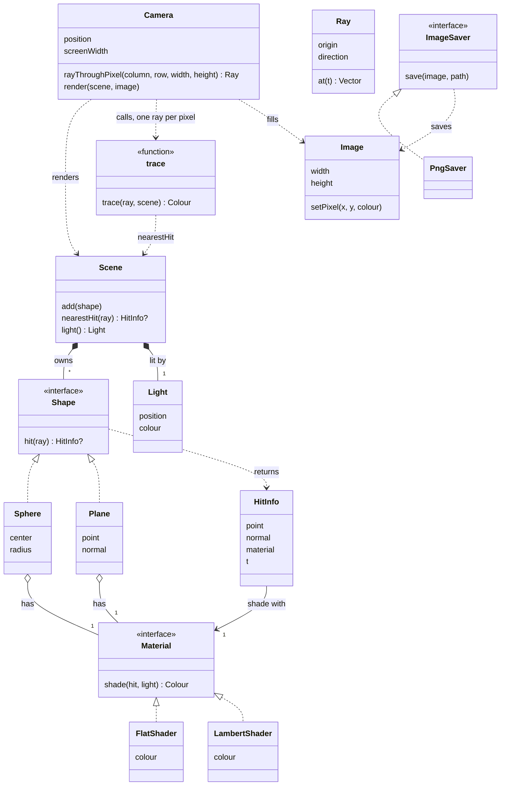

# Domain model

The concepts of the ray tracer and how they relate, as of milestone m1: a ball resting on a floor, lit by one point light.

## Concepts

| Concept | What it is | Where |
|---|---|---|
| **Vector** | A point or direction in 3D, with `+`, `-`, `*`, `dot` and `normalised`. | `src/math/` |
| **Ray** | An origin and a direction. `at(t)` is the point `origin + t * direction`. | `src/ray/` |
| **Colour** | Red, green and blue components, usually in [0, 1]. | `src/colour/` |
| **Light** | A point light: a position and a colour. | `src/light/` |
| **Shape** | Anything a ray can hit. Its only method is `hit(ray)`. | `src/geometry/shape.hpp` |
| **Sphere** | A shape given by a centre and a radius. | `src/geometry/sphere.*` |
| **Plane** | An infinite flat shape given by a point and a normal, e.g. a floor. | `src/geometry/plane.*` |
| **HitInfo** | Where a ray hit a shape (`point`), which way the surface faces (`normal`), the shape's `material`, and the ray parameter `t`. | `src/geometry/hit_info.hpp` |
| **Material** | How a surface is shaded: `shade(hit, light)` gives its colour. A shape has one (ADR 0008). | `src/material/material.hpp` |
| **FlatShader** | A material with one colour everywhere, ignoring the light. | `src/material/flat_shader.*` |
| **LambertShader** | A matte material: colour × light colour × max(0, N · L). | `src/material/lambert_shader.*` |
| **Scene** | Owns the shapes and the light, and finds the nearest hit along a ray (ADR 0009). | `src/scene/` |
| **trace** | Turns a ray into a colour: the nearest hit, shaded by its material with the scene's light, or black. | `src/trace/` |
| **Camera** | Sits at a position looking along +Z. It builds one ray per pixel and fills an image with `trace`. | `src/camera/` |
| **Image** | A grid of colours, `width` × `height`. | `src/image/` |
| **ImageSaver / PngSaver** | Saves an image to disk. PNG uses LodePNG (ADR 0007). | `src/io/` |

## How a pixel gets its colour

1. `Camera::render` builds the ray through the pixel's centre.
2. `trace(ray, scene)` asks the scene for the nearest hit.
3. `Scene::nearestHit` asks every `Shape` for its hit and keeps the one with the smallest `t`.
4. If there is no hit, the pixel is black. Otherwise the hit's material shades it: `material->shade(hit, scene.light())`.
5. `PngSaver` writes the finished image to `image.png`.

## Not modelled yet

Shadows, reflections, several lights, and a camera that can look in any direction.
